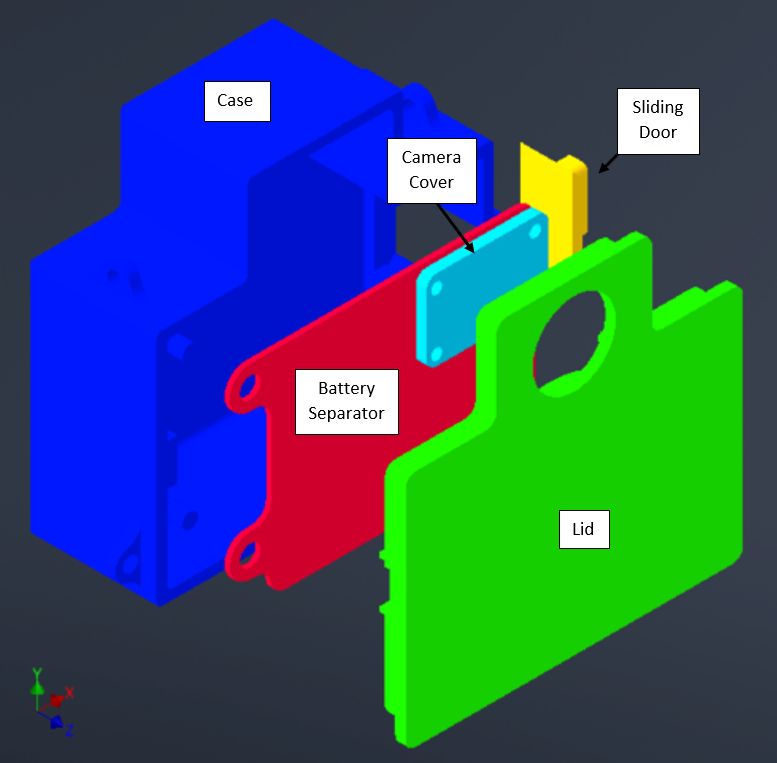
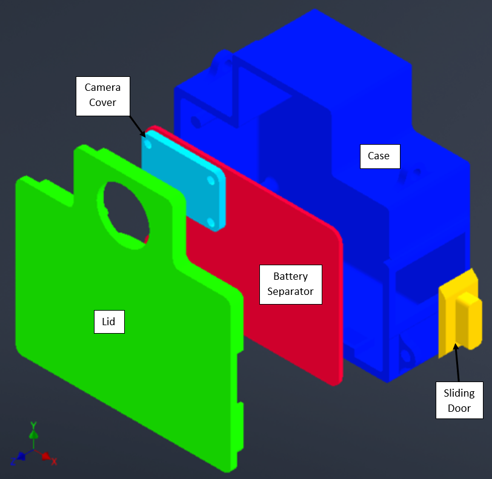
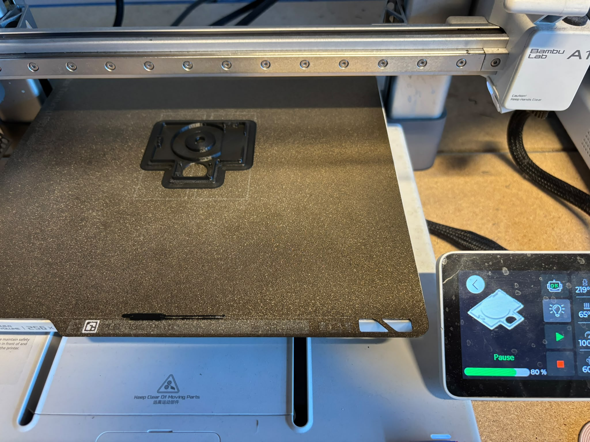
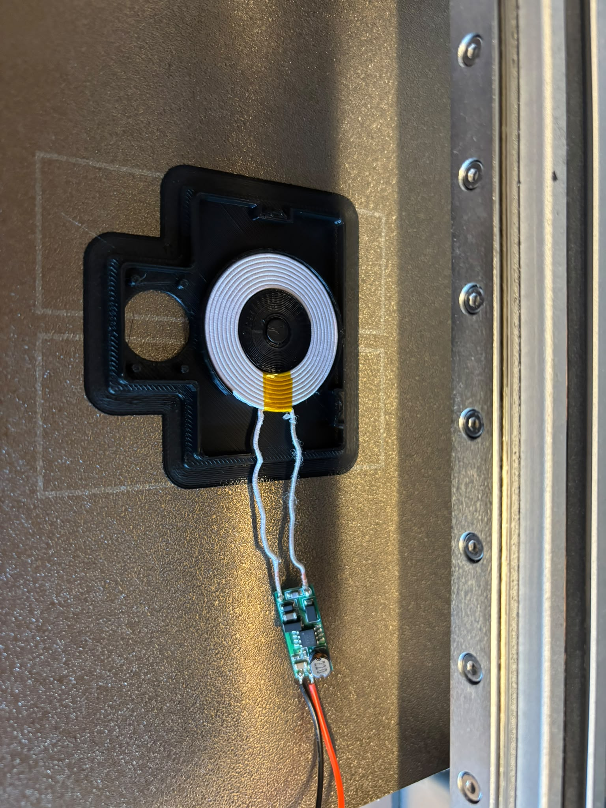
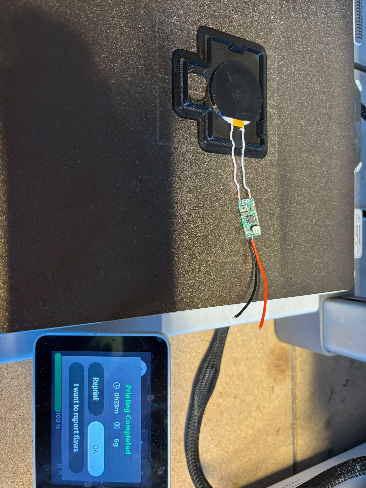
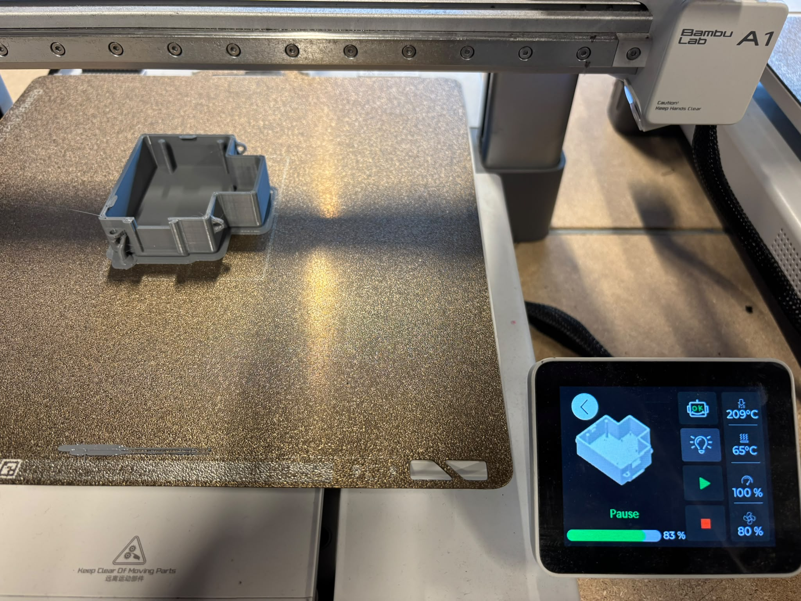
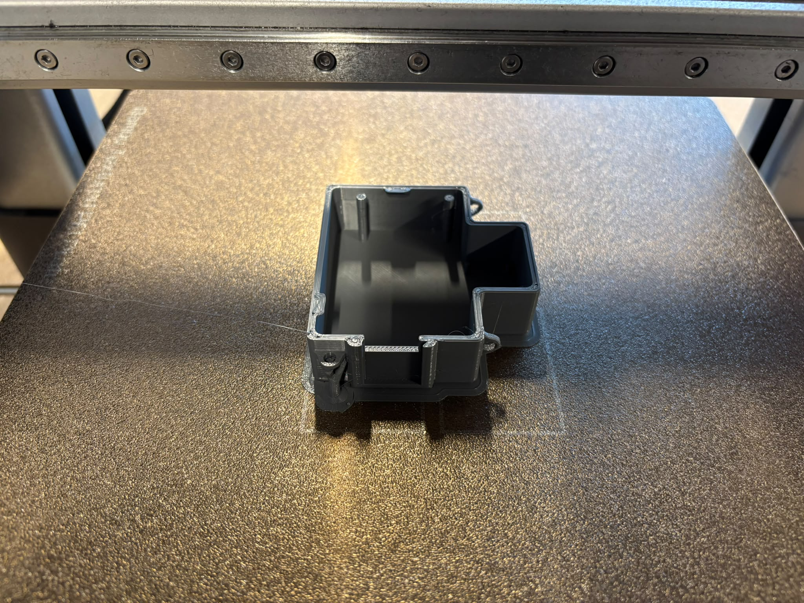

This folder contains the STL gcode files needed to make the PCB Case.

To insert the magnet and receiver coil into teh Lid of teh PCB Case, the print has to be paused at 79-80% percent, pay attention close attention when the 3D printer.

The magnet should be able to fit into the central hole and the wireless coil needs to be gently press fitted into the print.

Once that is done, resume the printing process.

Same process for the lid for the development board prototype.

To insert the Sliding Door, pause the print at around 83%, and place the sliding door into the slits. If the tolerances are too tight due to print warping or other causes, sand or cut the sides of the sliding door carefully until it fits. Don't sand or cut to much away, otherwise the door will be too loose.

Then resume print.

