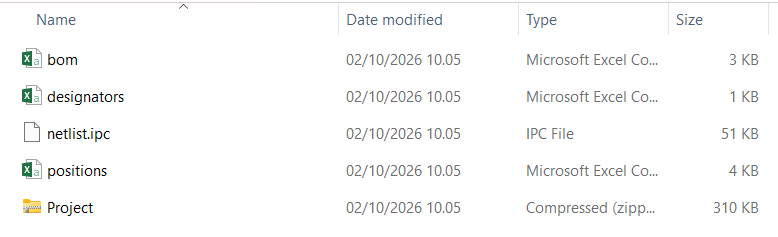
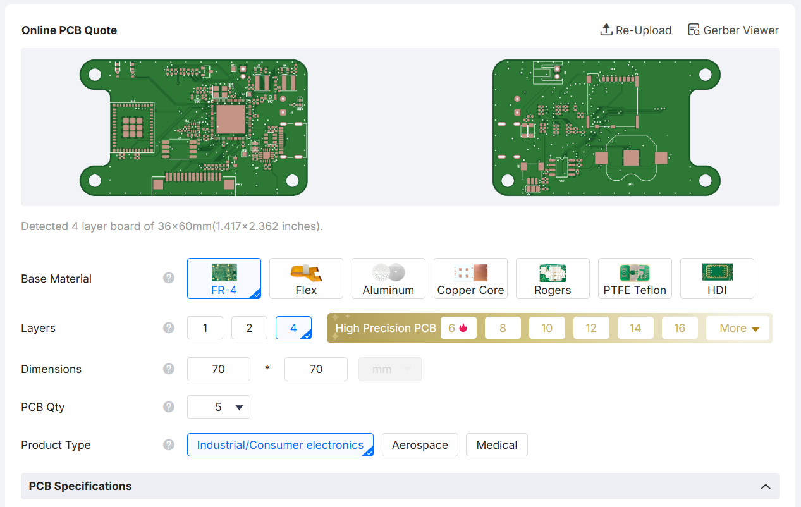
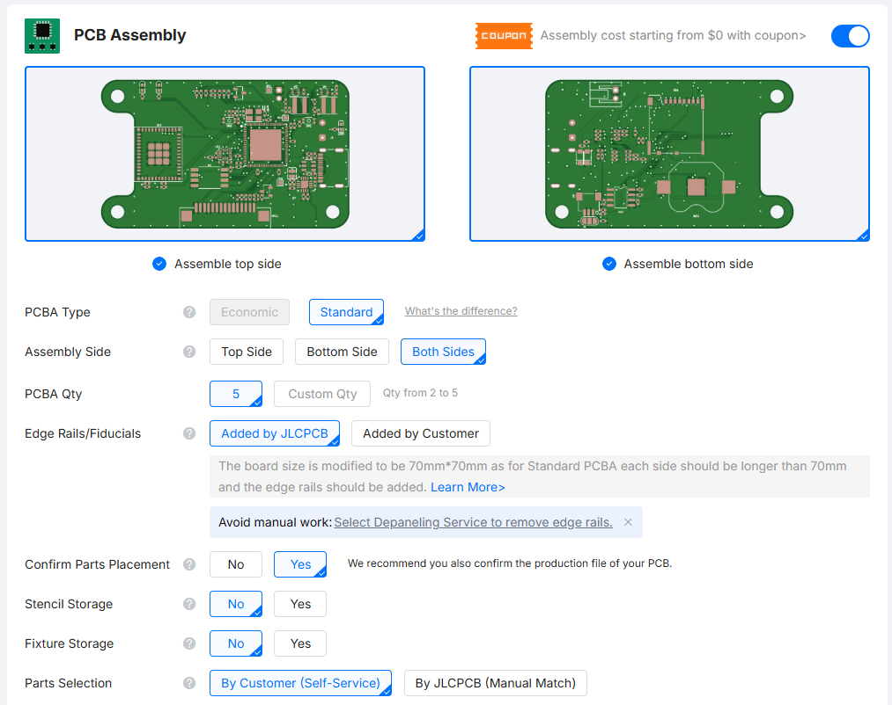
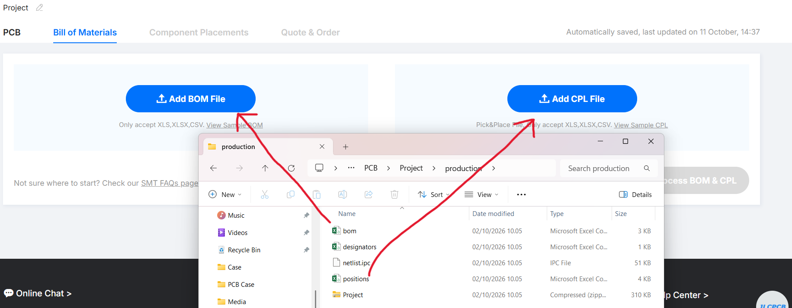
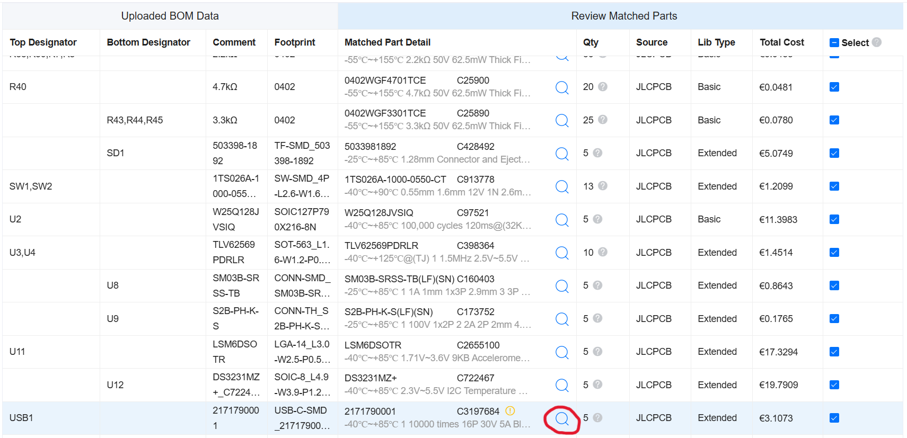
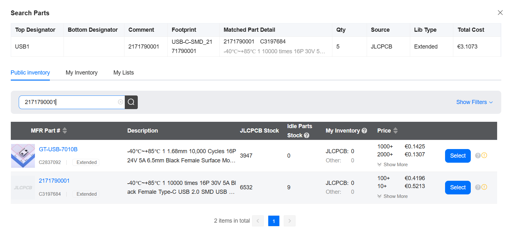

This folder contains the Schematic, PCB design and BOM of the device, how to order the PCB on JLCPCB, as well as the datasheets of the parts used for the PCB.

Open the folder that contains the production files to create the PCB (PCB->Project->production). Open the JLCPCB oder site, https://cart.jlcpcb.com/quote, and drag and drop the Project zip file that contains the gerber files into the gerber section. Select LeadFree HASL.

Under PCB Assembly, select Standard, Both Sides and Confirm Parts Placement. 

Drag and drop the BOM and Positions.

Double check the Bill of Materials and Components Placements. If everything is fine continue and place order. 

JLC will detect the parts and automatically add the parts to the order list. In case JLC doesn't auto detect a part, click on the search icon and manually add the part to the list.

